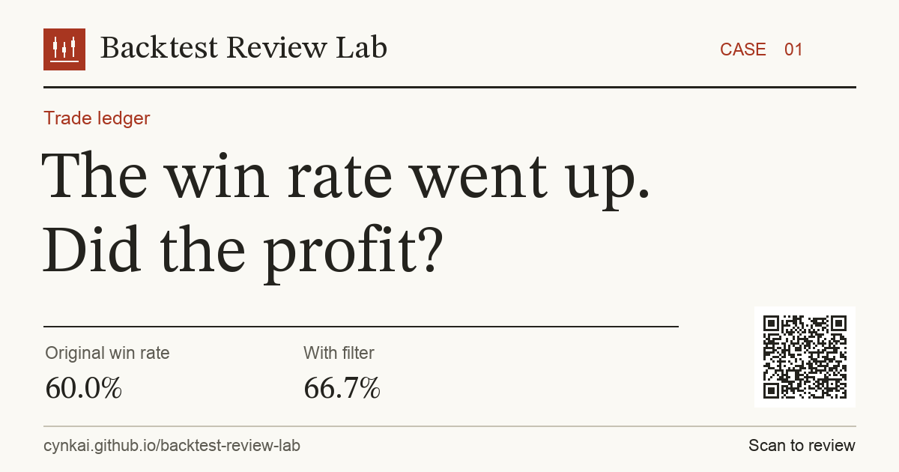

# Backtest Review Lab

An entry filter takes a strategy’s win rate from 60.0% to 66.7%. The author says it made more money. Would you approve the change?

[Open the five-trade ledger](https://cynkai.github.io/backtest-review-lab/?case=filter&lang=en) · [한국어로 풀기](https://cynkai.github.io/backtest-review-lab/?case=filter&lang=ko)

## The case files

| Case | What you get to inspect |
| --- | --- |
| [The higher win rate](https://cynkai.github.io/backtest-review-lab/?case=filter&lang=en) | Five trades, including the two the filter skipped |
| [Two orders, one candle](https://cynkai.github.io/backtest-review-lab/?case=candle&lang=en) | A five-minute bar, a stop order and a take-profit order |
| [The round-trip receipt](https://cynkai.github.io/backtest-review-lab/?case=fees&lang=en) | Two fills and the commission on each |
| [The closing-price signal](https://cynkai.github.io/backtest-review-lab/?case=lookahead&lang=en) | An order deadline and the official closing price |

Each case uses synthetic records. Inspect the evidence and choose **approve**, **request changes**, or **request more evidence**. The review opens after your first call. In the candle review, switch between two price paths to see which exit triggers first. A downloadable question card includes a QR code that opens the unsolved case in the same language.

## Reproduce a verdict

Open the code panel after a verdict. Choose a language and download its source file. Each file runs independently with the standard library. From the directory containing the downloaded file, use the command for your language.

| Language | Example | Run |
| --- | --- | --- |
| Python 3 | [check.py](docs/checks/filter/check.py) | `python3 check.py` |
| Rust | [check.rs](docs/checks/filter/check.rs) | `rustc check.rs -o check && ./check` |
| Go 1.21+ | [check.go](docs/checks/filter/check.go) | `go run check.go` |
| Java 17+ | [Check.java](docs/checks/filter/Check.java) | `java Check.java` |

To run the entire set, clone the repository and run `node tests/check-cases.mjs all` with the four toolchains on your PATH. To run one language, replace `all` with `python`, `rust`, `go`, or `java`. The checks compare each program’s output with the evidence shown in the browser.

## Use it in a study group

Send a fresh case link or show the question card before discussing the verdict. To try it offline, open `docs/index.html` in a browser. The site keeps first decisions in memory as you switch cases or languages during the current page session. The pilot timer counts time while the case is selected and the page is visible. Participants can copy their own pilot record if they want to send it to a facilitator. The site sends no verdicts or timing data to the project.

If a case sparked a disagreement, or a real review gave you an idea for another one, [leave a note](https://github.com/cynkai/backtest-review-lab/issues/new?template=feedback.yml). GitHub issues are public.

## 한국어

[거래 원장](https://cynkai.github.io/backtest-review-lab/?case=filter&lang=ko), [5분봉과 두 주문](https://cynkai.github.io/backtest-review-lab/?case=candle&lang=ko), [체결 명세서](https://cynkai.github.io/backtest-review-lab/?case=fees&lang=ko), [종가로 낸 매수 신호](https://cynkai.github.io/backtest-review-lab/?case=lookahead&lang=ko) 중 하나를 고르세요. 판정 뒤에 Python·Rust·Go·Java 풀이를 골라 내려받을 수 있습니다. 5분봉 사례에서는 두 가격 경로를 바꿔 보며 어느 주문이 먼저 체결되는지 확인할 수 있습니다. 스터디에서는 화면 아래의 **문제 카드 저장 (PNG)** 으로 정답이 가려진 카드를 공유하세요.

Maintaining the static site

After editing files in `docs/checks/`, run `node scripts/bundle-checks.mjs` to refresh the offline source previews. CI verifies that they match the downloadable files.

To exercise the browser flow, install Playwright with `npm install --no-save --no-package-lock playwright`, run `npx playwright install chromium`, and then run `node tests/browser-review.mjs`. Set `CHROMIUM_PATH` to use an existing Chromium binary.

The share cards are ready-to-use PNGs under `docs/cards/`. To regenerate them, install Pillow and segno in a development environment. Run `python3 scripts/make-cards.py --serif PATH --sans PATH --korean PATH` with local font files. For the last argument use a font with Hangul glyphs.

[MIT License](LICENSE)
